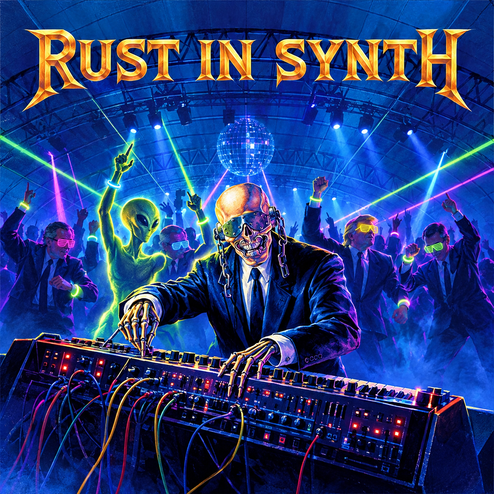

# RustInSynth

<p align="center">
  
</p>

A Minimoog-style synthesizer written in pure Rust with a real-time GUI, **true stereo output**, a **16-slot modulation matrix**, and both **standalone and plugin (VST3/CLAP)** operation.

## Features

**Sound engine**
- **4-oscillator bank** with 5 waveforms (Sine, Triangle, Saw, Square, Noise) + PolyBLEP anti-aliasing. OSC 4 is silent by default and doubles as an audio-rate modulator (FM / ring mod)
- **Three filter topologies** - SVF (LP/HP/BP/Notch taps), 4-pole Ladder and Comb - plus a serial **Filter 2** stage with its own type, cutoff and resonance
- **Dual ADSR envelopes** - amplitude (VCA) and filter (VCF) with 6-octave filter envelope range, plus two auxiliary ADSRs (**Env 3** and **Env 4**) used as matrix sources
- **3 LFOs** - 5 waveforms each, free-running or **tempo-synced**
- **Mono/Poly modes** - monophonic with key stacking OR 8-voice polyphony with voice stealing
- **Portamento (glide)** with exponential curve (0.005-2.0 seconds)

**Modulation**
- **Routing matrix** - 16 slots, each `source -> destination` with a bipolar amount. Sources: LFO 1-3, Amp/Filter Env, Env 3/4, Velocity, Key Track, Mod Wheel, Aftertouch, Pitch Bend, Osc 4 (audio rate), Constant. Destinations include per-oscillator pitch/level/pan, both filters' cutoff/resonance, amplitude, stereo width and LFO rate/depth (mod-on-mod)
- **Tempo sync** - LFOs and the delay lock to a BPM (user-set in standalone, host transport in the plugin)

**Effects & stereo**
- **True stereo output** with per-oscillator panning, stereo width, and independent L/R filters
- **Stereo effects chain** (Distortion -> Chorus -> Delay -> Reverb): multi-type Distortion (Tube, Fuzz, Bitcrush, Fold), Wide Chorus, Ping-pong Delay (tempo-syncable), Stereo Reverb

**Workflow**
- **Dual operation modes** - Standalone app AND VST3/CLAP plugin via NIH-plug
- **Unified GUI** - single codebase drives both standalone and plugin via the `SynthBackend` trait
- **Tabbed `egui` GUI** - SYNTH | ROUTING MATRIX | PRESETS pages
- **Preset browser** - themed banks (Bass, Lead, Pad, Keys, Pluck, Seq, FX, User), save/load, ~75 factory presets that showcase the matrix and tempo sync
- **USB MIDI controller support** via `midir` with live CC feedback, runtime CC learn, channel selection and aftertouch
- **MIDI CC control** for the 45 spec-driven parameters with customizable mappings
- **Single parameter spec** (`param_spec.rs`) drives GUI sliders, CC scaling and plugin automation, so standalone and plugin behave identically
- **Lock-free parameter sharing** between GUI and audio threads
- **Real-time CPU meter** - actual DSP load measurement

## Architecture

```
 OSC 1 ─┐
 OSC 2 ─┼─ pan/level ─▶ Filter 1 ─▶ Filter 2 ─▶ Amp (VCA) ─▶ Effects ─▶ Output
 OSC 3 ─┤            (SVF/Ladder/Comb) (optional)    ▲     Dist→Chorus→Delay→Reverb
 OSC 4 ─┘                                            │
   │ (audio-rate FM/RM source)                       │
   ▼                                                 │
 ┌──────────────── Modulation Matrix (16 slots) ─────┴──────────────┐
 │ LFO 1-3 · Amp/Filter Env · Env 3/4 · Velocity · KeyTrack ·        │
 │ ModWheel · Aftertouch · PitchBend · Osc 4 · Constant              │
 └───────────────────────────────────────────────────────────────────┘
```

See [ARCHITECTURE.md](ARCHITECTURE.md) for details.

**Default patch**: OSC1=Saw, OSC2=Saw+7¢ (slight detune), OSC3=Square-12st (sub bass), OSC4 silent

## MIDI CC Mappings

All parameters follow MIDI Sound Controller conventions:

### Amplitude Envelope (VCA)
| CC  | Parameter     | Range      |
|-----|---------------|------------|
| 73  | Attack Time   | 1ms → 2s   |
| 83  | Decay Time    | 1ms → 5s   |
| 84  | Sustain Level | 0% → 100%  |
| 72  | Release Time  | 1ms → 5s   |

### Filter Envelope (VCF)
| CC  | Parameter       | Range      |
|-----|-----------------|------------|
| 103 | Filter Attack   | 1ms → 2s   |
| 104 | Filter Decay    | 1ms → 5s   |
| 105 | Filter Sustain  | 0% → 100%  |
| 106 | Filter Release  | 1ms → 5s   |
| 107 | Filter Env Amt  | 0% → 100%  |

### Filter
| CC  | Parameter  | Range                |
|-----|------------|----------------------|
| 74  | Cutoff     | 20Hz → 20kHz (exp)   |
| 71  | Resonance  | 0% → 100%            |

### Oscillators
| CC  | Parameter      | Range                              |
|-----|----------------|------------------------------------|
| 75  | OSC1 Waveform  | 0-25=Sine, 26-51=Sq, 52-77=Saw, 78-103=Tri, 104+=Noise |
| 76  | OSC2 Waveform  | (same)                             |
| 77  | OSC3 Waveform  | (same)                             |
| 80  | OSC1 Level     | 0% → 100%                          |
| 81  | OSC2 Level     | 0% → 100%                          |
| 82  | OSC3 Level     | 0% → 100%                          |
| 78  | OSC2 Semitones | -24 → +24 (CC 64 = 0)              |
| 79  | OSC3 Semitones | -24 → +24 (CC 64 = 0)              |
| 85  | OSC2 Cents     | -100 → +100 (CC 64 = 0)            |
| 86  | OSC3 Cents     | -100 → +100 (CC 64 = 0)            |
| 87  | OSC1 Phase     | 0° → 360°                          |
| 89  | OSC2 Phase     | 0° → 360°                          |
| 90  | OSC3 Phase     | 0° → 360°                          |

### LFO
| CC  | Parameter       | Range                           |
|-----|-----------------|---------------------------------|
| 108 | LFO Rate        | 0.1 → 20 Hz                     |
| 109 | LFO Depth       | 0% → 100%                       |
| 110 | LFO Waveform    | 0=Sine, 1=Tri, 2=Sq, 3=Saw, 4=Rand |
| 111 | LFO Destination | 0=Off, 1=Pitch, 2=Filter, 3=Amp |

### Pitch Bend
| Control | Parameter       | Range                    |
|---------|-----------------|--------------------------|
| Wheel   | Pitch Bend      | ±range (default ±12 st)  |
| CC 102  | Pitch Bend Range| 1 → 24 semitones         |

### Portamento
| CC  | Parameter        | Range                      |
|-----|------------------|----------------------------|
| 5   | Portamento Time  | 0.0 → 3.0s (exponential)  |

The tables above cover the original default mappings. Newer parameters (OSC 4, Filter 2, filter type, distortion, effects, stereo) live in the parameter spec and can be bound with runtime **CC learn**. Matrix routes, LFO 2/3 and Env 3/4 settings, and tempo are preset/GUI state only: not CC-mapped and not host-automatable.

CC mappings are fully configurable at runtime via the `CCMapping` API. Custom mappings are persisted to `~/.rustinsynth/cc_mappings.json`.

## Presets

Presets are JSON files in `~/.rustsynth/presets/`, written in the **v2 format** (`{"format_version": 2, "preset": {...}}`). Legacy v1 bare-preset files still load, and missing fields fall back to defaults. A preset captures all oscillators (incl. OSC 4), both filters, all envelopes, 3 LFOs with sync settings, the full modulation matrix, tempo, effects, stereo and polyphony settings.

Factory presets are built into the binary (they always resolve to the current built-in version) and are organised into themed banks: **Bass, Lead, Pad, Keys, Pluck, Seq, FX**, plus **User** for your own saves. Use the PRESETS tab to browse, load and save.

**Programmatic usage:**
```rust
use rust_in_synth::core::{VoiceManager, save_preset, load_preset};

let mut vm = VoiceManager::monophonic(44100);
// ... configure the sound ...
let preset = vm.create_preset("My Bass");
save_preset(&preset).expect("Failed to save preset");

let loaded = load_preset("My Bass").expect("Failed to load preset");
vm.apply_preset(&loaded);
```

## Keyboard Layout

```
Upper row: Q W E R T Y U I  (C5 to C6)
Black keys: 2 3   5 6 7     (sharps/flats)

Lower row: Z X C V B N M ,  (C4 to C5)
Black keys: S D   G H J     (sharps/flats)

Controls:
  ↑/↓   - Octave up/down
  F1-F4 - Waveform select
  ESC   - Quit
```

## Building

### Standalone Application

```bash
cargo build --release
```

### Plugin (VST3/CLAP)

```bash
cargo build --release --features plugin
```

The plugin binaries will be in `target/release/` with `.so` (Linux), `.dll` (Windows), or `.dylib` (macOS) extensions. Use a plugin scanner or copy to your DAW's plugin folder. `bundle_vst3.sh` creates a VST3 bundle on macOS only.

## Running

### Standalone

```bash
cargo run
```

Connect a USB MIDI controller or use the keyboard shortcuts (see above).

### Tests

```bash
cargo test
```

## Dependencies

- `cpal` - Cross-platform audio I/O
- `midir` - MIDI input handling
- `egui` / `eframe` - Immediate-mode GUI
- `parking_lot` - Fast synchronization primitives
- `dashmap` - Lock-free concurrent hashmap
- `serde` / `serde_json` - Preset serialization
- `dirs` - Home directory lookup for presets and CC mappings
- `nih_plug` / `nih_plug_egui` - VST3/CLAP plugin framework (BillyDM fork)

## Project Structure

```
src/
├── main.rs                       # Entry point (standalone GUI mode)
├── lib.rs                        # Library exports
├── audio/
│   └── engine.rs                 # Audio stream + param/mod-state sync (standalone)
├── core/
│   ├── effects.rs                # Distortion, Chorus, Delay, Reverb + EffectsChain
│   ├── envelope.rs               # AR/ADSR envelopes
│   ├── event.rs                  # Note/CC/aftertouch event system
│   ├── factory_bank.rs           # Themed factory presets (matrix/sync showcases)
│   ├── filter.rs                 # SVF, Ladder, Comb filters + FilterType
│   ├── lfo.rs                    # Low Frequency Oscillator
│   ├── mod_matrix.rs             # ModSource / ModDest / ModSlot routing matrix
│   ├── oscillator.rs             # Waveform generators + 4-osc bank (PolyBLEP)
│   ├── param_spec.rs             # Single source of truth for all parameters
│   ├── params.rs                 # CC mapping system + SynthParam enum
│   ├── presets.rs                # v2 JSON presets, library, original factory presets
│   ├── types.rs                  # Core type definitions (StereoSample)
│   └── voice.rs                  # Voice manager (mono/poly, 8 voices), ModState
├── gui/
│   ├── mod.rs                    # SharedState, ParamBank, exports
│   ├── app.rs                    # SynthApp — single GUI, backend-agnostic
│   ├── backend.rs                # SynthBackend trait (unified abstraction)
│   ├── backend_standalone.rs     # StandaloneBackend (AudioEngine + MIDI)
│   ├── panels.rs                 # Shared panels: tabs, matrix grid, preset browser
│   ├── theme.rs                  # Rust In Peace color theme
│   └── widgets.rs                # Custom knobs, toggles, curve-aware sliders, meters
├── input/
│   ├── midi.rs                   # MIDI input handler (standalone)
│   └── keyboard.rs               # QWERTY keyboard input
├── plugin.rs                     # NIH-plug plugin definition
└── plugin_gui/
    ├── mod.rs                    # Module exports
    ├── backend_plugin.rs         # PluginBackend (NIH-plug integration)
    ├── editor.rs                 # Plugin editor (shared panels)
    ├── shared_state.rs           # PluginSharedState (CPU load, mod state)
    └── widgets.rs                # Plugin widget helpers
docs/
└── feature-roadmap.md            # Design notes for matrix / sync / filters / distortion
```

## Unified GUI Architecture

Both the **standalone application** and the **NIH-plug plugin** share a single GUI codebase through the `SynthBackend` trait abstraction.

```
              ┌──────────────────────────────┐
              │        SynthApp              │
              │  (one GUI, backend-agnostic) │
              └──────────────┬───────────────┘
                             │ Box<dyn SynthBackend>
              ┌──────────────┴───────────────┐
              │                              │
   ┌──────────▼──────────┐      ┌────────────▼────────────┐
   │  StandaloneBackend  │      │     PluginBackend<'a>    │
   │  (owns AudioEngine, │      │  (wraps Arc<Params> +   │
   │   SharedState, MIDI)│      │   &'a ParamSetter)       │
   └─────────────────────┘      └─────────────────────────┘
```

### Key design decisions

- **`SynthBackend` trait** (`src/gui/backend.rs`) — defines `get_param()`, `set_param()`, effects, voice management, stereo, MIDI, modulation state (`mod_state()` / `set_mod_state()`), and CPU load.
- **`StandaloneBackend`** — owns `AudioEngine` + `SharedState`. Implements MIDI polling and CC-learn.
- **`PluginBackend<'a>`** — holds `Arc<RustInSynthParams>` + `&'a ParamSetter`. Recreated cheaply each frame. MIDI methods are no-ops (host handles routing).
- **`SynthApp`** stores `Box<dyn SynthBackend + 'static>`, satisfying `eframe::App`'s `'static` requirement for standalone. For the plugin, `PluginBackend` is used as `&mut dyn SynthBackend` without boxing.
- **Adding a new feature**: add it to `param_spec.rs` (if it is a plain parameter), implement it in `SynthBackend`, `StandaloneBackend` and `PluginBackend`, add UI in `panels.rs` — one change covers both modes.

See [PLAN.md](PLAN.md) for the development plan.

## Current Status

**Unreleased (post-1.2.0; `Cargo.toml` still says 1.2.0)** - Modulation, filters & presets overhaul:
- [x] 16-slot modulation matrix with ROUTING MATRIX tab (source / destination / amount / enable per slot)
- [x] 3 LFOs and 2 auxiliary envelopes (Env 3, Env 4) as matrix sources
- [x] OSC 4 with audio-rate FM / ring-mod routing
- [x] Tempo sync for LFOs and delay (standalone BPM, plugin follows host transport)
- [x] Ladder and Comb filters, SVF Notch tap, serial Filter 2
- [x] Distortion unit (Tube, Fuzz, Bitcrush, Fold) first in the FX chain
- [x] Preset format v2 (versioned envelope, v1 still loads), categories and banks
- [x] Preset browser tab and ~75 themed factory presets
- [x] Tabbed GUI shared by standalone and plugin
- [x] Aftertouch input
- [x] Standalone/plugin parity work: single param spec, one curve per parameter, shared CC scaling, host automation gestures
- [ ] Manual DAW verification of the new features is still pending

**Known gaps:** global-effect matrix destinations (delay / reverb / chorus targets) are selectable but not yet applied by the DSP; matrix amounts, extra LFO/Env settings and tempo are not exposed as host-automatable plugin parameters.

**v1.2.0** - Stereo Fix & Unified GUI Architecture:
- [x] Fixed stereo separation with independent left/right filters per voice
- [x] `SynthBackend` trait abstraction — single GUI codebase for standalone and plugin
- [x] `StandaloneBackend` wrapping `AudioEngine`, `SharedState`, and MIDI handler
- [x] `PluginBackend<'a>` wrapping NIH-plug `RustInSynthParams` + `ParamSetter`
- [x] Effects parameters (delay/reverb/chorus) exposed via NIH-plug automation
- [x] `EffectsChain` unified setter/getter API
- [x] Plugin editor using identical panel functions as standalone GUI
- [x] `PluginSharedState` for lock-free CPU load sharing
- [x] Unified stereo width and oscillator pan across standalone and plugin

**v1.0.0** - True Stereo Output & VST3/CLAP:
- [x] VST3 and CLAP plugin export via nih-plug
- [x] 32+ automatable parameters in DAWs
- [x] Per-oscillator panning (L/R positioning)
- [x] Stereo width control (mono to extra-wide)
- [x] Ping-pong delay with stereo feedback
- [x] True stereo reverb (different L/R reflections)
- [x] Wide chorus with LFO phase offset
- [x] GUI controls for pan and width

**v0.9.0** - Effects Chain:
- [x] Delay effect (time, feedback, mix)
- [x] Reverb (Schroeder-style: 4 comb + 2 allpass filters)
- [x] Chorus (LFO-modulated delay)
- [x] GUI with enable toggles + parameter sliders
- [x] 8-voice polyphony with voice stealing
- [x] Factory presets (bass, lead, pad, FX, keys)

**v0.6.0** - Portamento + Key Stacking:
- [x] Portamento (glide) with exponential interpolation (0-3s)
- [x] Monophonic key stacking with proper note priority
- [x] Portamento works between stacked notes
- [x] MIDI CC 5 control for portamento time
- [x] GUI controls for portamento
- [x] Preset support for portamento settings

**v0.5.0** - Full GUI:
- [x] Real-time egui GUI with Minimoog-style layout
- [x] 3-oscillator bank with 5 waveforms (PolyBLEP anti-aliasing)
- [x] Per-oscillator waveform, level, phase, detune (semi + cents), pan
- [x] Resonant SVF filter with analog saturation
- [x] Dual ADSR envelopes (amplitude + filter)
- [x] LFO with 5 waveforms, 4 destinations
- [x] Pitch bend with configurable range
- [x] JSON-based preset save/load
- [x] MIDI input with live CC feedback display and CC learn
- [x] Lock-free GUI ↔ Audio parameter sync

## Roadmap

- [x] ~~Polyphonic voice allocation~~
- [x] ~~Effects chain~~ (Distortion, Chorus, Delay, Reverb)
- [x] ~~Stereo output~~
- [x] ~~VST3/CLAP plugin export~~
- [x] ~~Modulation matrix, extra LFOs/envelopes, tempo sync~~
- [x] ~~Additional filter types~~ (Ladder, Comb, HP/BP/Notch SVF taps)
- [x] ~~Preset browser~~
- [ ] Wire global-effect matrix destinations
- [ ] Arpeggiator
- [ ] Oscilloscope / envelope visualizers
- [ ] Standalone installers

## License

MIT
